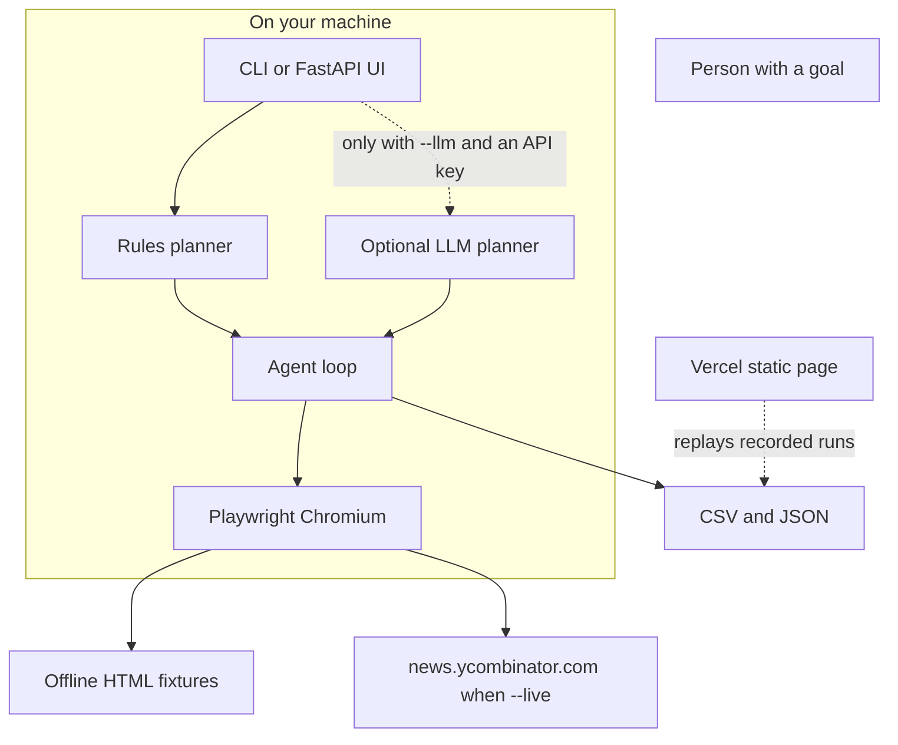

# WebHands

[](https://github.com/khajamujahid/browser-web-agent/actions/workflows/ci.yml)

An open-source browser agent with hands. You give it a goal in plain language. It opens a page, clicks, types, and brings back a table.

The default path is free and offline. It drives a real Chromium through [Playwright](https://playwright.dev/python/) against local pages, and it does not call a model. An optional planner can use an OpenAI-compatible API when you explicitly opt in.

Built by [Khaja Mujahiddin Mohammed](https://portfolio-one-theta-71.vercel.app/). Source: [github.com/khajamujahid/browser-web-agent](https://github.com/khajamujahid/browser-web-agent).

## What it is

WebHands is a small Python agent for people who want to see browser automation as a product, not a pile of selectors.

```bash
webhands run "Get the top 5 Hacker News titles and save them to CSV" -o hn.csv
```

The agent decides the task, opens the page, reads the stories, keeps the first five, and writes the file. You do not write the clicks.

Two goals ship with the repo:

| Goal | Hands | Result |
| --- | --- | --- |
| Top 5 Hacker News titles | Navigate, extract | `examples/outputs/hn_top5.csv` |
| Python books under $30 | Type, click, extract | `examples/outputs/python_books.json` |

## The problem

Scraping demos usually go one of two ways. A script hard-codes every selector, so a reader never sees a decision. Or a hosted "AI browser" needs a paid key before the first click, so a reviewer cannot run it.

WebHands sits in the middle. The goal is a sentence. The run is a real browser. The offline fixtures make the result the same on a laptop and in CI. When you want a live front page, you pass `--live`. When you want an open-ended plan, you pass `--llm` and your own key.

## How people use it

- **Try the demo.** Run the two examples. Open the CSV and the step trace. Nothing is billed.
- **Watch it work.** `webhands serve` starts a local page. Type a goal and read the log as each action finishes.
- **Script a one-shot.** The CLI writes CSV or JSON for the next tool in a pipeline.
- **Show the hosted replay.** The static page plays back those recorded runs. It does not pretend a cloud function launched Chromium.
- **Extend a task.** Add a fixture and a branch in the rules planner, or opt into the LLM planner for a sandboxed action list.

## Architecture



The rules planner never sends the goal anywhere. It maps a sentence onto one of the built-in tasks, then the agent perceives the page (title, story count, visible books) and acts. The LLM planner, when you turn it on, may only emit `goto`, `click`, `type`, `press`, and `extract`. Extractors are fixed. Arbitrary JavaScript from a model is not executed.

## Quickstart

Requires Python 3.11+.

```bash
git clone https://github.com/khajamujahid/browser-web-agent.git
cd browser-web-agent
python -m venv .venv
source .venv/bin/activate
python -m pip install -e ".[dev]"
python -m playwright install chromium
python examples/hn_top5.py
python examples/bookstore_search.py
webhands serve
```

Open [http://127.0.0.1:8000](http://127.0.0.1:8000). On Windows, activate the virtual environment with `.venv\Scripts\activate`.

Check the install:

```bash
python -m pytest
```

## Examples

Both examples run offline unless you pass `--live` to the Hacker News script.

```bash
python examples/hn_top5.py
python examples/bookstore_search.py
```

`examples/outputs/hn_top5.csv` from the local front page:

```csv
rank,title,url,points,comments
1,"Show HN: A browser agent that writes CSV, then stops",https://example.com/webhands,142,38
2,Playwright traces got small enough to read,https://example.com/traces,318,96
3,Local-first agents for people who do not want a cloud browser,https://example.com/local-first,256,74
4,"CSS selectors, explained without the magic",https://example.com/selectors,201,51
5,Ask HN: How do you test scrapers with the network unplugged?,https://example.com/offline-tests,178,143
```

`examples/outputs/python_books.csv` after the agent types `Python`, sets the ceiling to under $30, and clicks Search:

```csv
title,author,price,format
Think Python,Allen B. Downey,15.00,print
Automate the Boring Stuff with Python,Al Sweigart,0.00,digital
Python Crash Course,Eric Matthes,24.99,print
Web Scraping with Python,Ryan Mitchell,29.99,print
```

Fluent Python is on the shelf at $54.99, so it is not in the file. The JSON siblings include the same rows plus the step trace. Those traces are what the hosted page replays.

The Hacker News fixture uses the same `tr.athing` / `span.titleline` shape as the public front page, with invented headlines so the offline demo does not depend on a live site. A footer on that page says it is a fixture.

## CLI

```bash
webhands run "Get the top 5 Hacker News titles and save them to CSV" -o hn.csv
webhands "Search the bookstore for Python books under $30 and save them to JSON" -o books.json
webhands run "Get the top 5 Hacker News titles and save them to CSV" --live -o hn-live.csv
webhands run "Get the top 5 Hacker News titles and save them to CSV" --headed
webhands serve --port 8000
```

| Flag | Effect |
| --- | --- |
| `-o, --output` | Where to write. `.csv` and `.json` choose the format. |
| `--format` | `auto` (default), `csv`, `json`, or `both`. |
| `--live` | Read the public Hacker News front page. The bookstore stays local. |
| `--headed` | Show the Chromium window. `WEBHANDS_HEADED=1` does the same. |
| `--llm` | Use the optional model planner. Requires `OPENAI_API_KEY`. |
| `--allow-host` | Extra public host the LLM planner may open. Repeatable. |

`--live` is best-effort. The supported, tested demo is the offline fixture. If the public markup changes, the agent stops with an empty extract instead of writing a blank success.

Exit codes: `0` wrote a result, `2` the goal could not be planned, `1` the browser run failed.

## Local UI

`webhands serve` is a FastAPI app on your machine. One browser runs at a time. The page shows each step as it finishes, then the table, with CSV and JSON downloads.

The UI always uses the rules planner. It will not read an API key. That keeps a local server from sending goals to a model by accident.

Presets on the page are the two examples above. Other sentences that match the same shapes also work, for example `top five Hacker News titles` or `Python books at most $15`.

## Hosted demo

The static replay is the `demo/` directory. It plays the recorded offline runs in the browser, including the step log and the table. A goal it does not have on file does not produce invented rows.

Playwright cannot run on Vercel. A serverless function has no long-lived Chromium process, and the browser binary is far larger than the function bundle limit (Chromium alone is about 190 MB). The hosted page is a replay, not a cloud browser. Run `webhands serve` when you want a live session.

Live demo: see the URL below once this repo's Vercel project is published. Until then, serve it yourself:

```bash
python -m http.server -d demo 8765
```

Then open [http://127.0.0.1:8765](http://127.0.0.1:8765).

## Optional LLM planner

Leave this off for every default command. The rules planner covers the examples.

```bash
export WEBHANDS_LLM=1
export OPENAI_API_KEY=sk-...
export OPENAI_BASE_URL=https://api.openai.com/v1   # optional
export OPENAI_MODEL=gpt-4o-mini                     # optional
webhands run --llm "Open the bookstore fixture and list the Python books" -o books.json
```

`.env.example` lists the variables. This project does not load `.env` for you, so a forgotten key file cannot change a run. Export them in the shell.

Offline LLM plans may only open `fixture:hackernews.html` and `fixture:bookstore.html`. Live plans may open `news.ycombinator.com` plus hosts you pass with `--allow-host`. Localhost, link-local, and private IPs are rejected. URLs with passwords are rejected. Selectors are length-capped. Extract modes are `hn_stories`, `books`, `links`, and `headings`.

## Safety

- Default mode never leaves the package fixtures.
- The only built-in live host is the public Hacker News front page, and only with `--live`.
- The agent does not log in, import cookies, or solve CAPTCHAs.
- The local UI cannot call a model.
- Sample output is generated from fixtures, so the numbers in this README are demo data, not a scrape of today's front page.

## Tests and CI

GitHub Actions installs the package, installs Chromium, and runs pytest. See [`.github/workflows/ci.yml`](.github/workflows/ci.yml).

```bash
python -m pip install -e ".[dev]"
python -m playwright install chromium
python -m pytest
```

The UI test opens the local server and the static demo in Chromium, runs a goal, and checks the table. That is the check that the page works, not only that it renders.

## Layout

```
src/webhands/            agent, rules planner, Playwright session, CLI, FastAPI UI
src/webhands/fixtures/   offline Hacker News and bookstore pages
examples/                two runnable demos
examples/outputs/        CSV, JSON, and the step traces those demos produce
demo/                    static replay for Vercel
tests/                   planner, safety, browser, CLI, API, and UI tests
```

Direct dependencies are Playwright, FastAPI, and Uvicorn. Dev extras add pytest and httpx. There is no paid SDK on the default path.

## Author

[Khaja Mujahiddin Mohammed](https://portfolio-one-theta-71.vercel.app/) — senior software engineer. Portfolio and GitHub:

- https://portfolio-one-theta-71.vercel.app/
- https://github.com/khajamujahid

## License

[MIT](LICENSE). Copyright 2026 Khaja Mujahiddin Mohammed.
